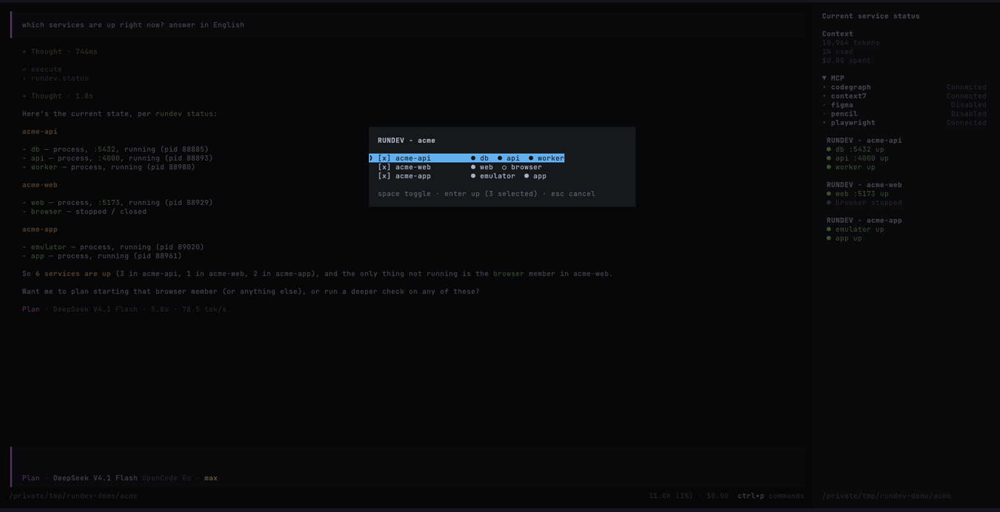
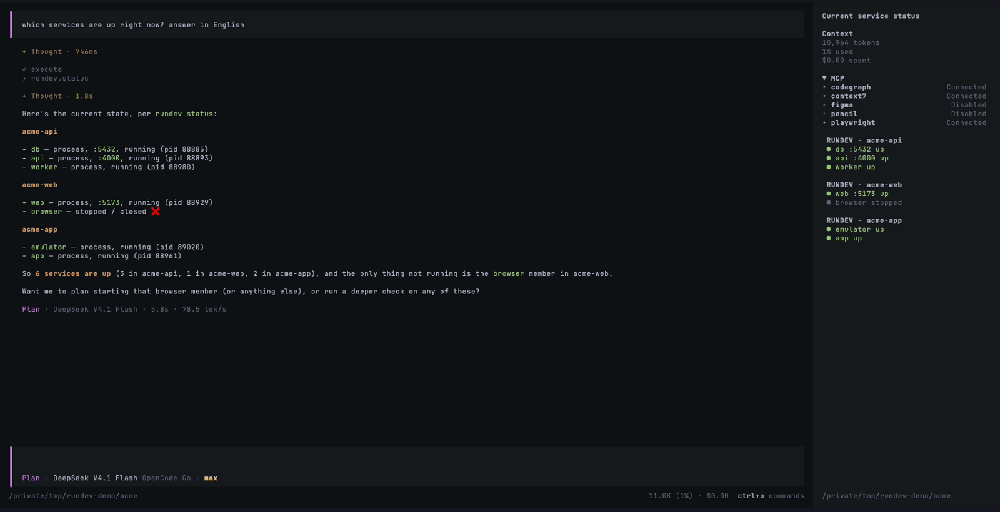
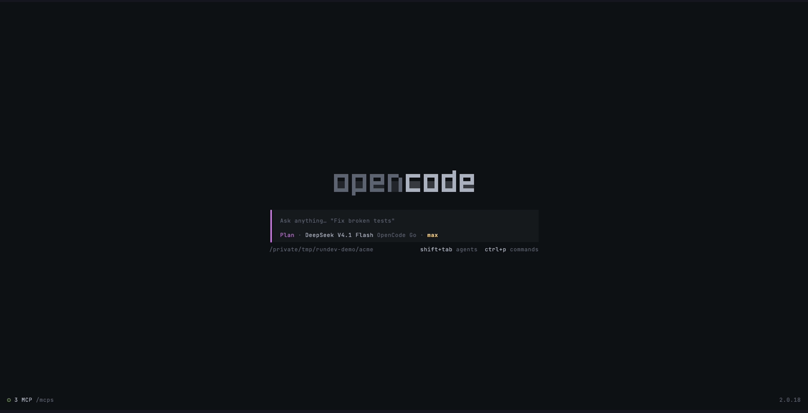
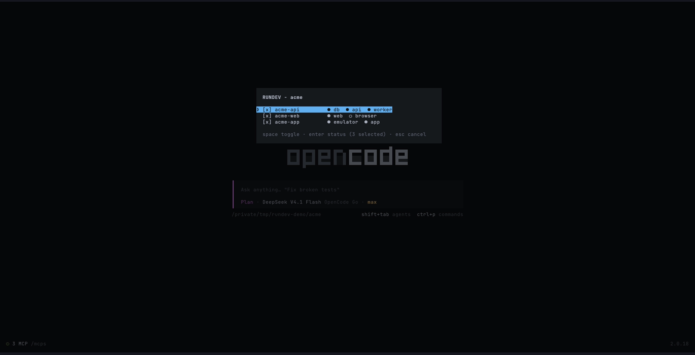

# opencode-rundev

[](https://www.npmjs.com/package/opencode-rundev)
[](https://github.com/angeloper86/opencode-rundev/actions/workflows/ci.yml)
[](https://github.com/angeloper86/opencode-rundev/blob/main/LICENSE)

**The VS Code "Run & Debug" for the terminal-first world.**

`rundev` brings a repo's dev environment up and down from OpenCode — containers, dev servers, the
emulator or simulator, and a browser with the project's own profile. No LLM in the loop, no `Ctrl+F5`,
no orphaned processes left behind.

```sh
/rundev up            # start whatever is missing (idempotent, port-preflighted, non-blocking)
/rundev up --dry-run  # the plan: ports, commands, resolved device — starts nothing
/rundev status        # what is up, who owns it, what is left orphaned, which ports are taken
/rundev down          # stop everything the manifest declares, verify, report
/rundev init          # scan the repo and draft the manifest (once per repo)
/rundev logs api      # follow a service log
/rundev doctor        # validate the manifest, the environment and the declared ports
```

Services take a target (`/rundev up app@ios`), and at a workspace root a member
(`/rundev up acme-app:app@ios`).

## Demo



The checkbox picker on the left (space toggles, enter brings up the chosen members) next to the live
sidebar on the right, as a sibling of OpenCode's own blocks. In the same workspace, below, the agent
answers with `rundev_status` — no configuration was written by hand.

<details>
<summary><b>More screenshots</b> (sidebar · report · picker)</summary>

### Sidebar



One block per repo, only the repos with something running, every service with its port and state.
Inside a repo it collapses to that repo's own services.

### Report



Every verb reports the same way, and the report is also mirrored into the transcript as a shell
message, so the model reads it as context.

### Picker



</details>

All screenshots come from a **throwaway workspace**, never from a real project: `docs/demo/setup.sh`
builds three fake repos in `/tmp` whose services are `sleep` processes (so the pids and the liveness
in the sidebar are real), and `docs/demo.tape` records them with [vhs](https://github.com/charmbracelet/vhs).


## Why

Working with an agent in the terminal is great until you have to **bring the project up**:

- the agent improvises: it reads prose, guesses commands, waits too long and leaves things hanging;
- what the agent started cannot always be stopped later;
- opening the app ends up using **your** browser, with your session and your history.

`rundev` moves that into a declarative per-repo manifest plus a deterministic engine. The agent
decides *what* it needs; the command knows *how* it starts and how it stops.

## Install

```jsonc
// opencode.json(c)
{
  "plugins": ["opencode-rundev"]
}
```

Requirements: OpenCode ≥ 2.0, macOS. App panels (`flutter run`…) open through **Ghostty ≥ 1.3's own
scripting API** (the first time, macOS asks to let OpenCode control Ghostty — *Automation*; the
Accessibility permission is **not** needed). With any other terminal the command is copied to the
clipboard for you to paste. iOS simulators are shown with whatever UI the installed Xcode ships:
**DeviceHub** on Xcode 27+ (`com.apple.dt.Devices`, inside the Xcode bundle) or `Simulator.app` on older
versions — the app is resolved at runtime, not assumed.

### Where the panel opens — and where it never does

rundev **never types into "whatever has the focus"**. The panel is a split of the terminal that hosts
*this* OpenCode session, addressed by that terminal's id: the TUI registers its tty, the server splits
that very terminal, runs the command in the new split and gives the keyboard back to where it was.
You can be in Figma, a form or a document while the app builds: nothing is typed there, and the panel
is waiting in your terminal when you come back. If the terminal cannot be identified for sure (no
Ghostty, an old Ghostty, two OpenCode terminals in one directory and no registered tty), **nothing is
opened**: the command goes to the clipboard and the report says why. `/rundev doctor` tells you which
terminal a panel would open next to. Flags: `--split=right`, `--focus` (keep the keyboard in the new
panel), `--strategy=clipboard|print|open` (`print` touches nothing: it only reports the command).
`RUNDEV_FLUTTER` points the emulator launch at another `flutter` (an fvm shim, a custom SDK).

## The manifest: `.opencode/rundev.json`

Every service declares **how it is checked** and **how it is stopped**. If it cannot be verified or
stopped, it does not belong in the manifest.

```jsonc
{
  "version": 1,
  "default": ["db", "api", "app@android"],
  "services": {
    "db": { "kind": "compose", "file": "docker-compose.yml", "service": "mysql", "port": 3306 },
    "api": {
      "kind": "process",
      "up": "yarn dev",
      "port": 4000,
      "health": "http://localhost:4000/health",
      "requires": ["db"]
    },
    "web": { "kind": "process", "up": "yarn dev -- --port 5173 --strictPort", "port": 5173, "requires": ["api"] },
    "browser": { "kind": "browser", "url": "http://localhost:5173", "profile": ".opencode/.chrome-profile", "requires": ["web"] },
    "app": {
      "kind": "interactive",
      "up": "flutter run",
      "defaultTarget": "android",
      "targets": {
        "android": { "requires": ["emulator"], "envSection": "ANDROID" },
        "ios": { "requires": ["simulator"], "envSection": "IOS" }
      }
    },
    "emulator": { "kind": "emulator", "avd": "pixel_8_api_36", "waitMs": 180000 },
    "simulator": { "kind": "simulator", "device": "iPhone 16", "waitMs": 90000 }
  }
}
```

### Kinds

| kind | What it is | How it is checked | How it is stopped |
|---|---|---|---|
| `compose` | A `docker compose` service | `docker compose ps` | `docker compose stop` (never `-v`) |
| `process` | A host server (`yarn dev`, `deno task dev`) | pidfile + `check`/`health` | SIGTERM to the group, then verify |
| `browser` | Chrome with the project profile | `pgrep` by profile | closes only that profile |
| `interactive` | Something that opens a panel (`flutter run`) | `check` when declared, otherwise the panel itself (Ghostty tells whether it is still there and still running) | rundev forgets the panel |
| `emulator` | An Android AVD | `adb devices` + `adb emu avd name` (the **declared** AVD, any case) | `adb emu kill` of **the one rundev booted**, fire-and-forget |
| `simulator` | An iOS simulator | `xcrun simctl list booted` (the **declared** device, by name or udid) | `xcrun simctl shutdown` of **the one rundev booted** |

`requires` (any service) lists what must be up first; a cycle is a validation error. `default` entries may
carry a target (`"app@ios"`). **Only the documented fields exist**: anything else is ignored at run time,
so `doctor` lists it as a warning and `rundev_apply` refuses to write it (`healt` → "did you mean
`health`?"; `dependsOn` is not a thing — use `requires`).

### Kind `interactive` and targets

`interactive` is anything that opens a terminal panel (`flutter run`, an Expo dev client, a REPL).
`targets` describe the device/platform variants; `requires` names the services that must be up first
(the emulator, the simulator, the API) and `envSection` the `.env` section the target needs.

`target.device` is optional and usually **should be omitted**: rundev resolves the real device from
`requires` — the emulator whose AVD is the declared one, the simulator whose name is the declared one —
and passes `-d <device>` to a `flutter run` that has not decided one. With two emulators or two
simulators on, the app goes to **the declared one**, never to "the first". If the declared device is not
up the launch gets no `-d` and the plan says so. A pinned serial (`emulator-5554`) that is no longer
connected is ignored in favour of the AVD: serials change between boots.

### Machine overrides

Machine-specific values are detected for you: `init` runs `flutter emulators` / `xcrun simctl list`
and writes the AVD and simulator it finds into `.opencode/rundev.local.json` (gitignored). You can
still edit that file by hand — it just is not required.

The local file is a **patch**, not a replacement: `{ "services": { "app": { "targets": { "android":
{ "device": "emulator-5554" } } } } }` keeps the `requires`, `check` and `launch` the committed
manifest declares for that target.

## Uninstall

```sh
/rundev uninstall --dry-run     # see what would be removed
/rundev uninstall               # stop what is running, remove state, chrome profile, .gitignore entries
/rundev uninstall --all         # also remove .opencode/rundev.json (the manifest you wrote)
```

It never touches your files: only the state it generated, the profile it created and the `.gitignore`
lines it added. The global bits (the `plugins` entry in your OpenCode config) are printed as
instructions, not modified.

## House rules

- **`up` is idempotent and safe to call in parallel**: whatever is already up is left alone, and `up`/`down`
  of one repo are serialised, so two tool calls in the same turn (`api` and `app@ios`) never start a
  service twice. That includes panels: rundev remembers the panel it opened (with its Ghostty terminal
  id), so a second `up` never opens a duplicate. `down app` forgets it and `up app --force` relaunches
  it on purpose. `status` asks the terminal itself whether the panel is still there and still running
  something; a `check` on an `interactive` service (or on a `target`) makes a closed app detectable too.
- **Still booting is not failed.** A process that is alive but has not answered its `check`/`health` yet
  is reported as `starting` (not `failed`), and a second `up` **waits for it instead of restarting it** —
  restarting a server that needs 12 s to boot, every time something asks again, would never let it
  come up. The same goes for a flutter panel that is still compiling: its check does not pass yet but
  the panel is running, so `up` does not open another one. A command that dies at once
  (`deno: command not found`) is `failed`, with the last lines of its log.
- **Somebody else's server is not a conflict if it works**: a server you already run by hand on the
  port that answers its health check is `already up` — rundev uses it as is and never touches it. Only a
  listener that does not answer is `blocked`.
- **Ports are preflighted**: before starting anything, `up` checks the port the service will bind
  (`port`, or the one in its `health` URL) with `lsof`. A port held by a process rundev did not start
  **blocks** the service with the pid in the report — it never kills it and never starts on top of it.
  `doctor` lists every declared port with its state.
- **`up` reads the plan first when asked**: `--dry-run` resolves requires, ports, the launch command
  and the device, and starts nothing.
- **`down` only stops what rundev started.** A process of yours holding the port is reported, never killed.
  A bare `down` stops every service the manifest declares — and an emulator or simulator goes down only
  if **rundev booted it** (it leaves a marker); the iPhone you had open for another project is left
  alone. A process whose launcher exited but whose children kept serving is still stopped (rundev looks
  at the process group, not only the pid it recorded).
- **`down` stops the app in its panel.** For a panel rundev opened, Ctrl+C is sent **to that terminal**
  (by id, whatever has the focus) and only while something other than a shell prompt is running there:
  a pane that is already back at its prompt is never interrupted. `down --close` also closes the pane
  once what ran in it has ended; it never closes one that is still running.
- **It never deletes volumes or data.**
- **A broken manifest is never "empty"**: a `rundev.json` that is not valid JSON (a git conflict, a typo)
  is reported as such, and `rundev_apply` refuses to patch over it instead of erasing what it held.
- **`.env` is verified, and switched only when asked.** If the active section does not match the requested
  target, `up` stops and tells you the two ways out: `/rundev env IOS`, or `up … --switch-env` (the tool's
  `switchEnv: true`) to switch it and go on. A switch only comments/uncomments the `# SECTION` blocks and is
  always reported (`.env ANDROID → IOS`); rundev reads section names, never values. So "start the api and
  the app on ios" flows in one call even when the `.env` says ANDROID.
  Note for your OpenCode config: a `*.env` **deny** rule protects `.env` from the *agent's own* read/edit/shell
  — it does not apply to rundev, which switches the section itself inside the server. You do not need to
  loosen it for this to work, and keeping it keeps your secrets out of the model's context.
- **Independent services start at the same time.** `up` orders what it starts by `requires` and runs each
  level in parallel: the emulator boots while the database and the api come up, and `web` waits only
  for `api`. In a workspace, repos that do not depend on each other come up together, and a repo that
  has to wait for its dependencies already boots its emulator/simulator meanwhile (the slowest thing in
  the run). A service whose requirement failed is **not** started (`requires db, which failed`).
- **`requires` orders the launch**: the app pulls its `emulator`/`simulator` first, waiting (bounded) for
  boot before opening the panel, and the launch gets `-d <the device that is actually up>`.
- **The simulator UI is resolved, not assumed**: Xcode 27 ships **DeviceHub**
  (`com.apple.dt.Devices`, inside the Xcode bundle) instead of `Simulator.app`. `up` opens whichever the
  installed Xcode has and reveals an already-booted simulator; `doctor` prints which one it found.
- **A panel never opens in the wrong place**: see *Where the panel opens*. The split starts in the
  service's directory and the line keeps a `cd '<repo-root>' &&` guard for the clipboard case.

## Sidebar

The TUI plugin renders a live block in the sidebar with the repo's services and their state (from the
engine's snapshot plus pid liveness). Reports open in a dialog; progress shows up as toasts. State is
read from the **manifest root**, so a session opened in `apps/web` of a monorepo still sees it. Inside a
workspace member it also shows the repos its `up` brings up first (`RUNDEV - acme-api`), and in
workspace mode it follows every member's own events, so a member started from the root still reports.

## Workspace (sibling repos / monorepo)

When several repos live together, each with its own manifest, drop a `rundev.workspace.json` at the
parent (`/rundev init` there writes one for you):

```jsonc
{
  "name": "acme",
  "members": ["acme-api", "acme-web", "acme-app"],
  "dependencies": { "acme-app": ["acme-api"] }
}
```

- **The same words work from the root and from inside any member**: a member (`/rundev up acme-app`), a
  service (`/rundev up acme-app:app@ios`), or a bare service name — resolved first in the repo you are in,
  then in the one member that declares it (`/rundev up api app@ios` from inside `acme-app` starts the api
  that lives in `acme-api`). `--all` runs every member.
- `dependencies` come up **first, in their own repo**, even when you only name the dependent
  (`/rundev up app@ios` brings `acme-api` up); a repo that is both named and needed comes up whole.
  `--force` relaunches what you named, never the dependencies brought up on the way.
- `status` at the root shows every member; inside a member it also shows its dependencies. `down` stops
  only what you name (dependents before dependencies with `--all`) and tells you which dependencies it
  left running. `logs`, `env` and `doctor` take `member:service`, from the root or from another member.
- Members may be written as paths (`apps/api`); only a directory with **its own** manifest is a member.
  `doctor` checks the workspace file too: missing members, dependencies on a ghost, cycles.
- Outside a workspace there is **no cross-repo awareness at all**: a repo only ever sees its own manifest.
- A **session in a subfolder** of a repo (`apps/web`) uses the repo's manifest: `init` and `apply` edit
  that one and never plant a second manifest beside it.

## Timeline

Every report is mirrored into the session as a **shell message** (`!cat …`), exactly like running a
command with `!` in the composer: it stays in the history and the model reads it as context, with
**no extra model turn**. That is why `synthetic` messages are not used for this — those queue as user
messages and would be answered in the next turn.

## Tools for the agent

The same engine is exposed as tools (`status`, `up`, `down`, `logs`, `env`, `doctor`, `scan`, `apply`;
`tools.rundev.*` in Code Mode, `rundev_*` outside it). `up` and `status` are *pinned*, so the model sees
their signatures instead of having to search for them, and the descriptions are generated from **the
place the session is in**, so the agent sees the services, their targets and the workspace without
reading files:

```
repo acme-app (member of workspace acme) · services: emulator(emulator), app(interactive targets[android])
  · default: app · up brings acme-api up first · other members (addressable as member:service): acme-api[postgres, api]
  · call: tools.rundev.up({ services: ["app@android"] })
```

Tools never pop a dialog up in your TUI (the member picker is for the command you type), and `up`
accepts `dryRun` (the plan), `switchEnv` (switch the `.env` section the target needs), `all` and reports
progress while a 90-second simulator boot is running. Tool arguments are plain names: a `--flag` slipped
into `services` is dropped (flags are the declared parameters, not strings). The answers are written for a model: `starting` says "wait, do not
call me again", `manual` says "the command is on the user's clipboard", `blocked` says what holds the port.

`rundev_scan` returns the **committed manifest**, the machine overrides (`local`) and the `effective`
manifest (what runs), so the agent edits from facts instead of guessing. `rundev_apply` takes a
**patch** that is deep-merged into the committed file (a target only changes the fields it sends), or
a full `manifest`, plus `remove` for deletions. It validates the merged result and refuses to write a
broken manifest, a field rundev does not know, a `root` outside the session's repo/workspace, or a
patch over a file that is not valid JSON; then it reports what changed (added/changed/removed).

> **Permissions.** A manifest holds commands the next `up` will run, so `rundev_apply` declares its own
> permission action (`rundev_apply`): a rule such as
> `{ "action": "rundev_apply", "resource": "*", "effect": "ask" }` makes OpenCode ask first. The `.env`
> section switch is explicit, reported, and independent of any `*.env` deny rule (see the house rules).

Two skills ship with the plugin: `rundev` (how to drive the environment, what a failure means) and
`rundev-manifest` (how to write one with `scan → propose → approve → apply`).

### Tell your agents (AGENTS.md)

Agents cannot run `/rundev`: it is a user command. Give them the tools explicitly in `AGENTS.md`:

```md
## Dev environment

The dev environment (db, api, app, emulator) is declared in `.opencode/rundev.json`.
Do not start services by hand and do not run `/rundev` (that is a user command).
Use the rundev tools:

- `rundev_status()` — what is up, on which port, who owns it (every member in a workspace).
- `rundev_up({ services: ["api", "app@ios"] })` — starts what is missing, in order, in the right
  repo: from the workspace root or from inside any member (`api` may live in a sibling repo).
  Ports are preflighted; a taken port is reported with its pid, never killed. The app's panel opens in
  this session's own terminal; do not open one yourself. `starting` means it is booting: wait and
  call `rundev_status`, do not call `up` again.
- `rundev_up({ dryRun: true, services: [...] })` — the plan, starts nothing.
- `rundev_down({})` — stops what rundev started, the app in its panel included (never a
  simulator/emulator you had open).
- A target that needs another `.env` section (`ANDROID`/`IOS`): call `rundev_up` again with
  `switchEnv: true` when the user asked for that target. Never read or edit `.env` yourself.
- `rundev_apply({ patch: {...} })` — add/change a service or target; validated and it reports
  exactly what changed (never rewrite the file by hand).
```

Without that paragraph the agent has to discover the tools, the manifest and the device names on its
own — that is where the slow, improvised `docker compose` / `flutter run` attempts come from.

## Development

```sh
npm run typecheck                                               # types, including the TUI JSX
npm run smoke                                                   # engine (Deno): locks, "starting", devices with a fake adb/xcrun…
npm test                                                        # plugin layer (Node): repo / workspace root / member, apply, init
node --experimental-strip-types dev/harness.ts <dir> "<verb>"   # plugin pre-flight, no server
node --experimental-strip-types dev/harness.ts <dir> describe   # what the model sees (descriptions, skills)
```

The package ships TypeScript source (`src/`): OpenCode's plugin runtime loads it directly, the same
way it loads `.opencode/plugins/*.ts`.

## Status

v0.1 — developed and tested on macOS with Ghostty.
